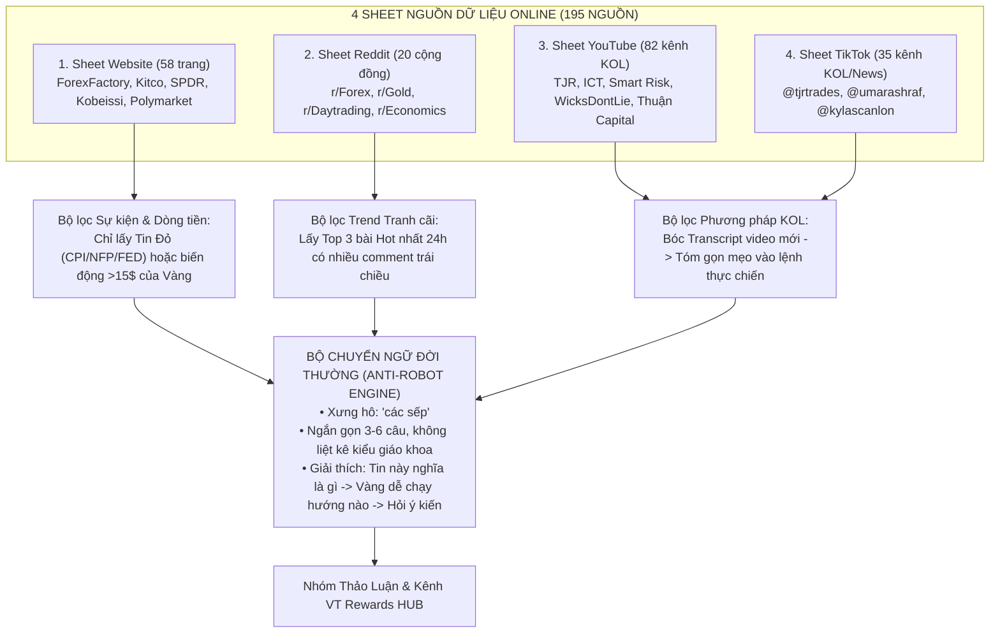

# ĐỀ XUẤT QUY TRÌNH & SKILL: BIẾN 4 NGUỒN TIN THÀNH "NGƯỜI ANH EM TRADER" GIỮ LỬA TRONG NHÓM

> [!IMPORTANT]
> **Đã cập nhật xong 4 Sheet (100% Nguồn Quốc Tế) lên Google Sheets Online của bạn:**
> Link: [NGUỒN TIN TỨC - Google Trang tính](https://docs.google.com/spreadsheets/d/1-HgPzrchtbVtyskdawDfx5Hum4eaJK-8COgJ2Ytdoik/edit?usp=sharing)
> - **Sheet 1 (`Website` — 56 nguồn Quốc tế):** Lịch kinh tế CPI/NFP/FED, Breaking News, Quỹ Vàng SPDR, và các trang chuyên kể chuyện dữ liệu siêu cuốn (*Kobeissi Letter, Visual Capitalist, Unusual Whales, Polymarket, Axios*).
> - **Sheet 2 (`YouTube` — 70 kênh Quốc tế):** Các KOL thực chiến hàng đầu thế giới (*TJR Trades, Raja Banks / WicksDontLie, Smart Risk, ICT, LamboRaul, Brad Goh, Jadecap, Umar Ashraf...*).
> - **Sheet 3 (`TikTok` — 35 kênh Quốc tế):** Các KOL Trading & Phân tích tin tức quốc tế (*@tjrtrades, @umarashraf, @wicksdontlie, @kylascanlon, @morningbrew, @wsj, @reuters...*).
> - **Sheet 4 (`Reddit` — 20 cộng đồng Quốc tế):** Các ổ bàn luận sôi động nhất thế giới (*r/Forex, r/Gold, r/Daytrading, r/InnerCircleTrader, r/Economics, r/wallstreetbets, r/geopolitics*).

---

## 1. TƯ DUY CỐT LÕI: TẠI SAO CÁCH ĐĂNG TIN TRUYỀN THỐNG THẤT BẠI?

Các nhóm trading thông thường đều chết lâm sàng vì đăng tin theo kiểu **"Bản tin robot"**:
- ❌ *Kiểu truyền thống (Không ai thèm đọc/rep):* `"🔔 BẢN TIN SÁNG: Hôm nay 19:30 công bố CPI Mỹ. Dự báo: 3.1%, Kỳ trước: 3.2%. Kịch bản 1: Nếu CPI > 3.1%... Chúc anh em giao dịch thành công!"` $\rightarrow$ Đọc xong member lướt qua luôn vì giống hệt báo đài, không có lý do để bình luận.
- ✅ *Kiểu "Người anh em trong nhóm" (Mục tiêu của chúng ta):* Bot đóng vai một người anh em trader chịu khó lướt tin quốc tế, xem clip KOL và nằm vùng Reddit rồi về **kể lại ngắn gọn 3–5 câu bằng ngôn ngữ đời thường + thả 1 câu hỏi gợi mở đúng chỗ ngứa**.

---

## 2. CÁCH KHAI THÁC & BIẾN TẤU TỪNG NGUỒN (4 SHEET $\rightarrow$ 4 KIỂU NÓI CHUYỆN ĐỜI THƯỜNG)

Hệ thống không quét tràn lan cả 195 nguồn cùng lúc mà chia thành **4 rổ nguyên liệu** với cách lọc và cách nói hoàn toàn khác nhau:

### Kiểu 1: Tin Tức Kinh Tế Lớn (CPI, Non-Farm, FED, Quỹ SPDR) — *Lấy từ Sheet `Website`*
- **Cách lọc:** Tự động lấy lịch tin Đỏ trong ngày + Giá Vàng hiện tại + Lượng mua/bán của quỹ SPDR hoặc tỷ lệ cược lãi suất trên *Polymarket / CME FedWatch*.
- **Cách Bot nói chuyện (Giải thích đời thường + Tác động + Gợi mở):**
  > *"Các sếp ơi, tối nay 19h30 lại tới hẹn lên đĩa với con tin CPI (lạm phát Mỹ) rồi. Hiểu nôm na là phố Wall đang cược lạm phát tháng này hạ nhiệt xuống 2.9% để ép FED sớm cắt lãi suất. Nếu tối nay số thực tế mà nhảy vọt lên trên 3.0% thì đồng Đô (DXY) dễ dựng cột, lúc đó Vàng khả năng cao bị đạp quét xuống một nhịp rát đấy. Ngược lại nếu CPI thấp như kỳ vọng thì phe Buy Vàng lại có cớ gồng tiếp. Tối nay các sếp tính ngồi ngoài xem kịch hay canh sẵn ở mốc nào?"*

### Kiểu 2: Câu Chuyện Phương Pháp / Video Mới Của KOL (TJR, Raja Banks, Smart Risk...) — *Lấy từ Sheet `YouTube` & `TikTok`*
- **Cách lọc:** Hàng ngày quét RSS/Video mới nhất của dàn KOL đầu bảng (như *TJR, WicksDontLie, Umar Ashraf, Smart Risk*). Tự động bóc phụ đề tiếng Anh (Transcript) $\rightarrow$ Lọc bỏ hoàn toàn đoạn quảng cáo sàn/quỹ của họ $\rightarrow$ Chỉ rút ra **1 mẹo giao dịch thực chiến duy nhất** trong video đó.
- **Cách Bot nói chuyện (Kể chuyện KOL vừa lên bài):**
  > *"Nay lướt thấy ông TJR vừa lên video mới mổ xẻ đúng cái bệnh vào lệnh sớm của anh em mình các sếp ạ. Ông ấy chỉ ra một mẹo khá hay khi đánh phiên Mỹ: Đừng bao giờ đặt Limit chặn đầu khi Vàng đang lao mạnh, mà phải đợi nó thọc râu quét sạch SL của đám đông ở đáy/đỉnh phiên Á (Liquidity Sweep), rồi chờ cây nến M5 đóng cửa rút râu quay ngược vào trong mới bóp cò. Nghe thì đơn giản mà thực chiến toàn bị ngứa tay vào sớm. Trong nhóm mình có sếp nào hay đánh theo kiểu đợi quét râu của TJR không, hay các sếp thích đánh Breakout hơn?"*
  *(Đính kèm trực tiếp ảnh Thumbnail gốc của video YouTube KOL đó + Link video gốc ở cuối bài).*

### Kiểu 3: Bắt Sóng Tranh Cãi & Tâm Lý Đám Đông — *Lấy từ Sheet `Reddit`*
- **Cách lọc:** Quét API JSON miễn phí của `r/Forex/hot.json` và `r/Gold/hot.json` lấy chủ đề đang có lượng bình luận (comments) cao nhất trong 12 giờ qua.
- **Cách Bot nói chuyện (Đưa góc nhìn đám đông quốc tế về nhóm mình bàn luận):**
  > *"Sáng giờ dạo một vòng trên ổ Reddit r/Forex với r/Gold thấy tụi Tây đang cãi nhau nảy lửa quanh mốc Vàng hiện tại các sếp ạ. Một nửa thì hô Vàng đã tạo đỉnh ngắn hạn phải chỉnh sâu 30-40 giá nữa, nửa kia thì bảo Ngân hàng Trung ương vẫn đang gom ngầm nên cứ chỉnh là múc. Nhìn biểu đồ H4 hiện tại theo các sếp thì phe nào đang nắm đằng chuôi?"*

---

## 3. LỊCH TRÌNH PHÂN BỔ TRONG NGÀY (NHỊP ĐỘ TỰ NHIÊN, KHÔNG SPAM)

Để nhóm luôn có sức sống mà không bị biến thành cái chợ spam tin, Bot sẽ hoạt động theo **2 cơ chế kết hợp**:

| Khung Giờ / Điều Kiện | Nguồn Lấy Tin Chính | Nội Dung & Mục Đích | Nơi Đăng |
| :--- | :--- | :--- | :--- |
| **08:30 – 09:00 Sáng** *(Đầu phiên Á)* | Sheet `Website` + `Reddit` | **Điểm tin sáng đời thường:** Đêm qua Vàng chạy sao, quỹ cá mập SPDR gom hay xả, hôm nay có tin gì đáng gờm và tụi Tây trên Reddit đang bàn vùng giá nào. | Kênh `@vtrewardshub` *(Tự nhảy sang Nhóm Thảo Luận)* |
| **14:00 – 15:00 Chiều** *(Vào phiên Âu)* | Sheet `YouTube` + `TikTok` | **Góc KOL Thực Chiến:** Chia sẻ nhanh 1 phương pháp/góc nhìn mới từ video của TJR, ICT, Smart Risk, Raja Banks... kèm câu hỏi thảo luận cách đánh. | Nhóm Thảo Luận *(Kèm ảnh minh họa nếu cần)* |
| **19:00 – 19:30 Tối** *(Trước phiên Mỹ / Trước tin Đỏ)* | Sheet `Website` (ForexFactory, FinancialJuice) | **Cảnh báo & Gợi mở trước giờ G:** Giải thích bình dân tin tối nay (CPI/NFP/FED/Trợ cấp thất nghiệp) ảnh hưởng thế nào tới túi tiền và giá Vàng, hỏi kịch bản anh em. | Nhóm Thảo Luận |
| **Cơ chế Động (`1B` Nâng cấp)** *(Khi nhóm im ắng > 3 tiếng)* | Kho mồi lửa tổng hợp trong ngày | Thả 1 câu hỏi ngắn (2–3 câu) xoáy thẳng vào **biến động giá Vàng vừa diễn ra** hoặc **1 thống kê thú vị** từ Kobeissi/Reddit để kéo anh em vào chém gió. | Nhóm Thảo Luận |

---

## 4. KIẾN TRÚC KỸ THUẬT: ĐÓNG GÓI THÀNH SKILL & SCRIPT TỰ ĐỘNG

Tôi sẽ xây dựng thành bộ công cụ chạy tự động gồm:
1. **`news_and_kol_radar.py` (Bộ Quét Đa Nguồn 4 Sheet):**
   - Đọc trực tiếp từ link Google Sheets 4 tab (`Website`, `YouTube`, `TikTok`, `Reddit`).
   - Tự động lấy: Giá `XAU/USD` & `DXY` thời gian thực + Lịch tin Đỏ trong ngày + Bài thảo luận Hot nhất trên `r/Forex`, `r/Gold` + Video/Transcript mới nhất từ các kênh KOL YouTube/TikTok.
2. **Bộ Chuyển Ngữ "Người Anh Em Trader" (`daily_buzz_pool.json`):**
   - Chuyển hóa toàn bộ dữ liệu khô khan vừa quét được thành các tin nhắn trò chuyện đời thường (tuân thủ nghiêm ngặt: gọi **"các sếp"**, không văn vở AI, tối đa 1–2 icon hoặc không dùng icon cho các câu hỏi gợi chuyện ngắn, không dính tên sàn khác).
   - Nạp trực tiếp vào [`bot_truc_nhom.py`](file:///C:/Users/PHONG/.gemini/antigravity/scratch/vt_community_system/bot_truc_nhom.py) để Bot tự động đăng theo lịch hoặc gõ lệnh `/lenbai` / `/goichuyen` trong nhóm Nội Bộ là nổ súng ngay.
3. **Đóng gói thành Antigravity Skill (`vt-community-radar`):** Để bất cứ lúc nào bạn mở Antigravity cũng có thể ra lệnh cập nhật, tinh chỉnh hoặc thêm nguồn mới trong 1 nốt nhạc.
